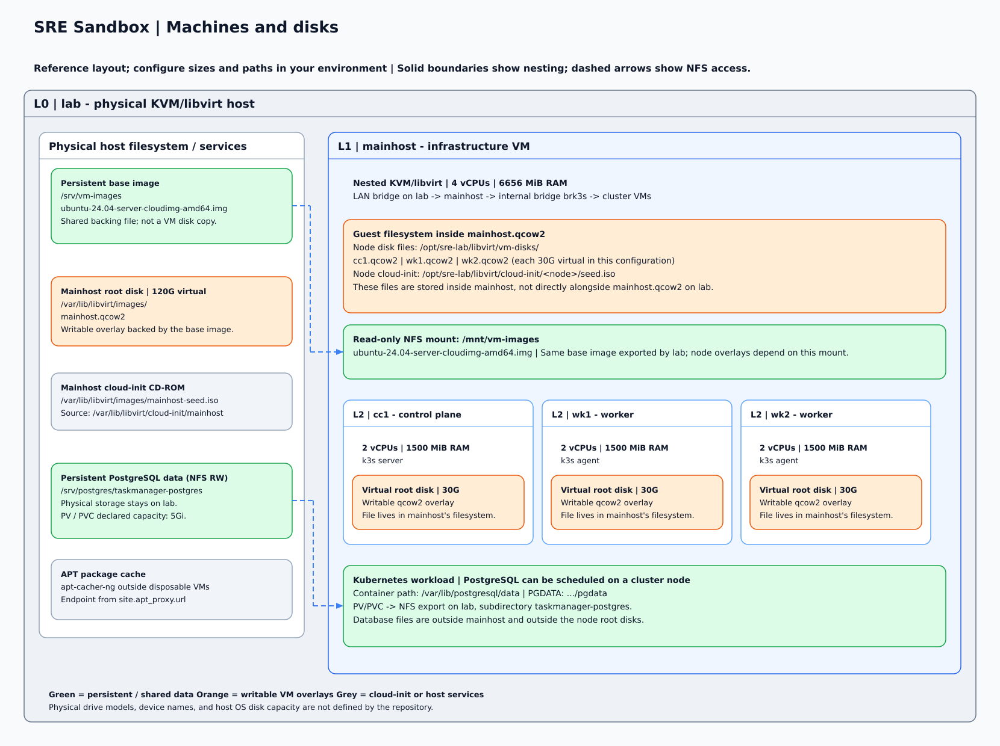

# SRE Sandbox

A learning project for building an SRE homelab with Ansible, nested KVM/libvirt,
and k3s. It covers infrastructure provisioning, Kubernetes, persistent storage,
and application deployment on a single physical computer.

## Architecture

| Layer | Host | Purpose |
| --- | --- | --- |
| Physical host | `lab` | Stable KVM host, LAN bridge, package cache, base-image storage, and NFS exports |
| Infrastructure VM | `mainhost` | Nested KVM host, internal network gateway, and Kubernetes administration |
| Cluster VMs | `cc1`, `wk1`, `wk2` | Disposable k3s control plane and two workers |

The physical host runs `mainhost`, which runs the three cluster VMs. Keeping
persistent data on `lab` allows the infrastructure VM and cluster nodes to be
recreated without deleting the PostgreSQL files.

Open the editable [draw.io diagram](docs/diagrams/architecture.drawio) in
draw.io / diagrams.net. It has two pages: virtualization layers and disk
dependencies. The diagram uses the example configuration; adapt labels when
changing VM sizes or storage paths.



See the [disk dependency view](docs/diagrams/storage.svg) for backing-file,
filesystem containment, and NFS relationships.

Ansible runs on a management machine with this checkout and SSH access to every
managed host. Kubernetes administration runs on `mainhost` as `ansik`.

## What to prepare

The lab depends on services supplied by your physical environment. Choose their
addresses and paths before adapting the configuration.

### Physical computer

- An x86-64 computer with Ubuntu, APT, systemd, and Netplan. Guest provisioning
  currently uses Ubuntu 24.04 amd64 cloud images.
- CPU virtualization enabled in BIOS/UEFI, working KVM on the physical host,
  and nested virtualization enabled so `mainhost` can run its own KVM guests.
- A wired interface that can be attached to a Linux bridge.
- Enough RAM and storage for the guests, host OS, base images, container images,
  and persistent database files.
- Console access for initial setup and recovery when changing host networking.

The current VM allocations provide a starting point for capacity planning:

| VM | vCPUs | RAM | Virtual disk |
| --- | --- | --- | --- |
| `mainhost` | 4 | 6656 MiB | 120 GB qcow2 overlay |
| Each cluster node | 2 | 1500 MiB | 30 GB qcow2 overlay |

These are configuration values, not measured minimum requirements. Cluster VMs
share the resources allocated to `mainhost`, and their disk files live inside its
disk. Physical storage must also hold the base image and persistent NFS data.

### Network, DHCP, and DNS

Provide an external DHCP server that assigns a fixed address to the physical
host through a reservation. The host still uses DHCP; its assigned address must
remain stable across reboots and bridge reconfiguration. Reserve a stable LAN
address for `mainhost` as well. Use the device identities from your own environment
when creating those reservations.

Prepare two non-overlapping networks:

| Network | Requirements |
| --- | --- |
| LAN | Physical host, mainhost LAN interface, management access, DHCP, gateway, and DNS |
| Internal cluster network | Static node addresses and a gateway address on mainhost; no DHCP server required |

The physical host bridges its LAN interface into `br0`. The mainhost VM connects
to that bridge. Its internal bridge, `brk3s`, provides the cluster gateway.
Cluster node addresses are configured through cloud-init.

Provide routing from the management machine and physical host to the cluster
network through mainhost's LAN address. The upstream gateway must provide return
routing and Internet access for the cluster subnet. The playbooks enable IPv4
forwarding on mainhost; upstream routing, NAT where needed, DHCP reservations,
and external firewall configuration belong to your environment.

Allow SSH, NFS, package-proxy traffic, and k3s communication between the relevant
hosts. Provide working DNS and outbound access to Ubuntu package/image sources,
the k3s installer, container registries, and Python package sources used by the
sample application.

### APT proxy bootstrap

By default, `make prepare_lab` installs and starts `apt-cacher-ng` on the physical
`lab` host before configuring any APT clients. No preinstalled local proxy is
required. The package cache stays outside the disposable VM layers, reducing
traffic and setup time when mainhost and cluster VMs are recreated.

Set `site.apt_proxy.manage_on_lab: true` and use
`http://<lab-address>:3142` as `site.apt_proxy.url`. Bootstrap installs missing
proxy packages using direct HTTP/HTTPS access, explicitly bypassing an existing
APT proxy setting. After the service is running and accepting connections, the
`common` role configures lab to use it; VM cloud-init uses the same URL.
The physical host needs working direct package access for that initial install.
Subsequent runs skip package installation when the proxy packages are installed.

To reuse an externally managed proxy, set `manage_on_lab: false` and supply its
URL. In that mode, have the proxy running and reachable before preparation starts;
the project does not install or start it.

The cache covers APT traffic configured to pass through it. Container images,
Python dependencies, and cloud-image downloads need their own Internet access;
they are not cached by this APT configuration.

### Ubuntu image and NFS storage

Use an Ubuntu 24.04 amd64 **cloud image in qcow2 format**, rather than an installer
ISO. The image is the backing file for VM overlay disks.

| Consumer | Required access |
| --- | --- |
| Physical libvirt host | Local readable base-image file for creating the mainhost overlay |
| Mainhost | The same image available through a read-only NFS export, mounted at a stable path |
| Cluster nodes | A separate read-write NFS export on the physical host for PostgreSQL data |

Choose and configure the image source URL, local cache directory, filename,
export path, and mainhost mount path together. With the repository's path layout,
the image is stored under `/srv/vm-images` on the physical host and mounted at
`/mnt/vm-images` on mainhost. PostgreSQL uses a separate `/srv/postgres` export.
These paths can be adapted to your storage layout.

The lab preparation playbook can download a missing base image. Before creating
mainhost, verify the local image exists; before creating cluster VMs, verify the
NFS mount exposes that file. Keep the backing image and mount available while
overlays depend on them. Cache downloads on the physical host so rebuilding VMs
does not require downloading the image again.

The database export must allow the cluster subnet and the container's required
file access. The shipped permissions are deliberately permissive for a learning
lab; review them when adapting NFS. Keep its data on the physical host so VM
cleanup does not remove it.

### Management tools and credentials

Prepare a Linux management machine with Git, GNU Make, Python 3, Ansible
(ansible-core 2.16 or newer), and OpenSSH. Ansible needs these collections:

```bash
ansible-galaxy collection install ansible.posix community.libvirt community.general
```

Provide an Ed25519 SSH key pair and initial SSH/sudo access to the physical host.
Normal automation uses `ansik` with passwordless sudo. Cloud-init creates that
user on the VMs, so only the physical host needs a separate user bootstrap.

Create your own initial-login and privilege-escalation settings. The checkout
uses your production SSH key and bootstrap options. If you encrypt your own
inventory, provide a vault password file with `VAULT_ARGS` or put it at
`ansible/secrets/vault_pass.txt` for automatic detection. That directory is
excluded from Git.

## Configure your environment

Copy the example and edit one file:

```bash
cp ansible/environment.example.yml ansible/environment.yml
```

`ansible/environment.yml` supplies the addresses, subnets, uplink/bridge names,
APT proxy, image URL and paths, PostgreSQL export directory, and VM sizes.
The example uses illustrative networks; replace them with your own. Host names
remain `lab`, `mainhost`, `cc1`, `wk1`, and `wk2` because the inventory groups and
workflow use those names.

VM MAC addresses are optional. Libvirt assigns them when omitted; cluster
cloud-init matches the single Ethernet interface by name. If your external DHCP
server requires a fixed mainhost MAC for its reservation, supply your own
`site.mainhost.mac` in the environment file. Reserve the selected address before
provisioning, or use your DHCP server's discovered lease to establish the mapping.
Changing MACs on an existing VM requires deliberate recreation; the automation
does not replace existing VM definitions.

Leave `site.apt_proxy.manage_on_lab` set to `true` to bootstrap the proxy on lab,
or set it to `false` for an already running external proxy. Set
`site.images.download` to `false` when supplying a preloaded image. The expected
filename is `site.images.filename`; it must match the file in the image export.
Image and database NFS exports are hosted on lab in this architecture.

Run a local validation before contacting any host:

```bash
make check_config
```

Every Make workflow runs this check first. It checks subnet membership, address
and optional MAC uniqueness, node roles, paths, URLs, and required values.
It does not test service availability. Use `ENV_FILE=/absolute/path/to/site.yml`
to select another environment file for any Make target.

Access settings remain in the inventory: production uses `ansik` and your local
Ed25519 key. Pass initial SSH/sudo options with `EXTRA_ARGS` during bootstrap.
A vault password file is only needed if your own inventory contains encrypted
values; set `VAULT_ARGS` when using a different vault setup.

For direct Ansible commands, pass `-e @environment.yml` from the `ansible/`
directory. Make supplies this argument automatically. Shared role defaults and
cloud-init derive their environment values from that file; application manifests
are rendered on mainhost before kubectl uses them.

## Build and verify

Run Make targets from the repository root after adapting the configuration and
preparing the services above.

Bootstrap the physical host once if `ansik` does not exist yet. Replace
`initial-admin` with your existing login; omit password prompts when your initial
access already uses keys and passwordless sudo:

```bash
make bootstrap EXTRA_ARGS='-u initial-admin --ask-pass --ask-become-pass'
```

Then run the layers in order:

| Step | Command | Result |
| --- | --- | --- |
| 1 | `make prepare_lab` | Prepare physical host packages, bridge, cache, NFS, and base image |
| 2 | `make create_mainhost` | Create the infrastructure VM |
| 3 | `make prepare_mainhost` | Prepare nested KVM, internal bridge, routing, and NFS client |
| 4 | `make create_vms` | Create the three cluster VMs |
| 5 | `make prepare_vms` | Prepare packages and kernel settings for k3s |
| 6 | `make bootstrap_k3s` | Install the control plane, then the agents |
| 7 | `make kubeconfig_mainhost` | Install kubectl and kubeconfig on mainhost |

Check that each layer is reachable before proceeding. On mainhost, run
`kubectl get nodes -o wide`; expect `cc1`, `wk1`, and `wk2` to become Ready.
The k3s ServiceLB component is disabled and Traefik remains enabled.

`create_vms`, `prepare_vms`, and `bootstrap_k3s` accept `LIMIT`, for example
`make prepare_vms LIMIT=wk1`. Install the control plane before bootstrapping a
worker. For direct Ansible use, `hosts:` selects the layer, `--limit` selects
hosts, and `--tags` selects functionality.

## Deploy the sample application

Taskmanager provides an nginx frontend, Flask API, and PostgreSQL database.
The destination is taken from your environment file:

```bash
make taskmanager_apply
```

The application playbook renders manifests with your environment values and runs
`kubectl apply` on mainhost. Check the pods, storage claim, and
services there with `kubectl -n taskmanager get pods,pvc,svc`.
The frontend is available at `http://<cluster-node-address>:30080` from a routed
client. PostgreSQL files remain on the physical host's NFS export.

The backend is delivered through a ConfigMap and installs Python dependencies at
startup. Building application images and using a registry are future steps.
Docker Compose is an optional standalone demo, separate from the k3s workflow.

See the [Kubernetes workflow](k8s/README.md),
[Taskmanager deployment](k8s/taskmanager/README.md), and
[Compose demo](taskmanager/README.md) for details.

## Stop, clean, and rebuild

| Command | Effect |
| --- | --- |
| `make stop_k3s_vms` | Stop cluster VMs |
| `make stop_mainhost` | Stop the infrastructure VM |
| `make shutdown_lab` | Shut down the physical host |
| `make shutdown` | Attempt shutdown in order: cluster, mainhost, physical host |
| `make taskmanager_delete` | Delete demo Kubernetes resources; retain the NFS files |
| `make clean_k3s_vms` | Delete cluster VM definitions, disks, and cloud-init files |
| `make clean_mainhost` | Delete mainhost and its VM-local data, including nested disks |
| `make reset_and_shutdown` | Clean disposable layers, then shut down the physical host |

Stop/cleanup playbooks start at `200-*`. Rebuild disposable layers by repeating
their creation and preparation steps. Keep backups of persistent data separately.

## Development conventions

Preserve the `lab` → `mainhost` → `k3s` layers, keep Kubernetes administration on
mainhost, and keep persistent database storage on the physical host. Use `lab_*`,
`mh_*`, and `k3s_*` for layer-specific roles; shared roles keep generic names.

Keep shared settings in inventory/group variables, prefer incremental changes,
and keep comments concise and in English. Maintain idempotency: check real state,
assign one owner per resource, and keep cloud-init artifacts in stable paths.
Avoid competing NFS permission tasks and unconditional changed results.

Next learning stages include MetalLB,
application image delivery, Prometheus, Grafana, and centralized logging.
